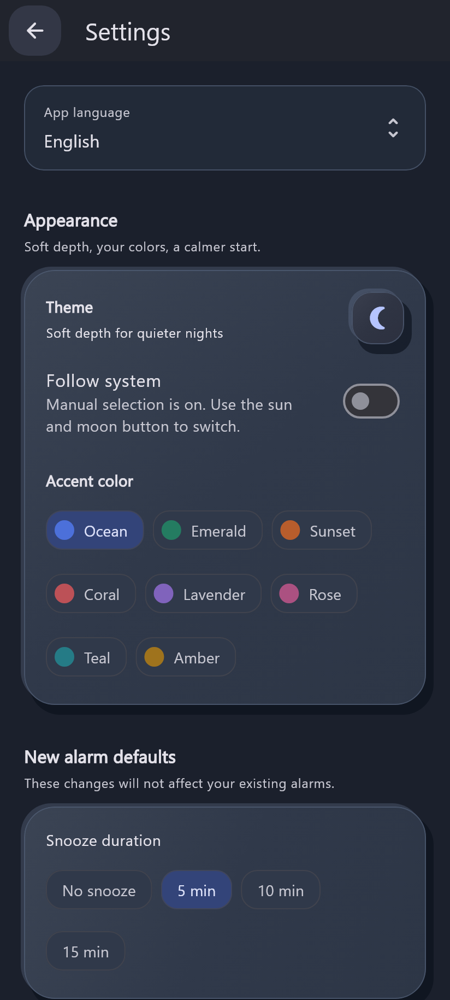
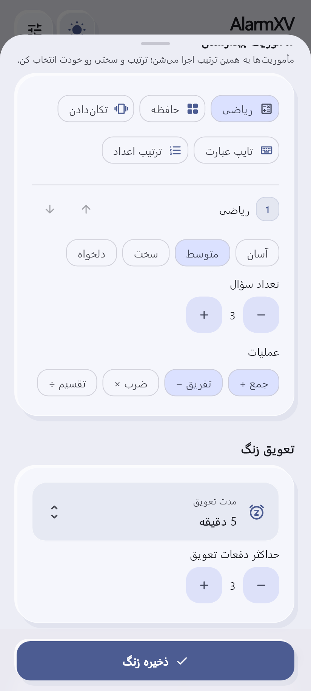

# AlarmXV

### صبح از اینجا شروع می‌شه · Your morning starts here

An open-source Android alarm clock with wake-up missions, Clay surfaces and Persian/English support.

[**Download · دانلود نسخهٔ پایدار**](https://github.com/bardia-us/AlarmXV/releases/tag/v2.0.0) · [Latest release](https://github.com/bardia-us/AlarmXV/releases/latest) · [Changelog](CHANGELOG.md) · [Issues](https://github.com/bardia-us/AlarmXV/issues)

**2.0.0** · Flutter + Kotlin · Android · [GPL-3.0](LICENSE)

&nbsp;

Sample alarms · زنگ‌های نمونه؛ اطلاعات واقعی کاربران نیست

## دانلود · Download

**2.0.0** نسخهٔ پایدار جدید AlarmXV است؛ با کد **5007** روی نسخه‌های قبلی نصب می‌شود.

**2.0.0 is the current stable release**, with versionCode **5007** for upgrading existing installations.

| APK | مناسب برای · Best for | Size |
|---|---|---:|
| [ARM64 · v8a](https://github.com/bardia-us/AlarmXV/releases/download/v2.0.0/AlarmXV-2.0.0-arm64-v8a.apk) | بیشتر گوشی‌های جدید · Most modern phones | 18.1 MiB |
| [ARMv7 · v7a](https://github.com/bardia-us/AlarmXV/releases/download/v2.0.0/AlarmXV-2.0.0-armeabi-v7a.apk) | گوشی‌های قدیمی ۳۲ بیتی · Older 32-bit ARM phones | 15.7 MiB |
| [Universal](https://github.com/bardia-us/AlarmXV/releases/download/v2.0.0/AlarmXV-2.0.0-universal.apk) | اگر مطمئن نیستی · When unsure | 52.3 MiB |

[SHA256 checksums · صحت فایل‌ها](https://github.com/bardia-us/AlarmXV/releases/download/v2.0.0/SHA256SUMS.txt)

فقط یکی از APKها را نصب کن. امضای قبلی AlarmXV حفظ شده؛ برای آپدیت نیازی به حذف برنامه نیست.

Install only one APK. All files retain the existing signing identity and support installation over the previous version.

## فارسی

AlarmXV برای صبح‌هایی ساخته شده که خاموش‌کردن آلارم، زیادی راحته. زمان بیداری رو انتخاب کن، زنگ‌هات رو مرتب کن و با یک زنگ عادی یا انجام مأموریت بیدار شو.

- **دو روش بیدارشدن:** زنگ عادی با قطع مستقیم و صدای قابل تنظیم، یا بیداری مأموریتی با ریاضی، حافظه، تکان‌دادن، تایپ و ترتیب اعداد.
- **آلارم‌های مرتب:** گروه با نام، رنگ و آیکون، جست‌وجو، تکثیر، تکرار هفتگی و شمارش زمان تا آلارم بعدی.
- **ظاهر یکپارچه:** طراحی Clay، نوارها و منوهای Frosted، تم روشن/تیره/سیستم، هشت رنگ و دکمهٔ متحرک ماه و خورشید.
- **دو زبان:** فارسی و انگلیسی با پیش‌فرض زبان سیستم و انتخاب دستی در تنظیمات؛ جهت مناسب RTL/LTR.
- **کنترل بیداری:** صدای گوشی، Snooze، مأموریت‌های قابل تنظیم و بررسی بی‌صدای بیداری با فرصت تأیید ۶۰ ثانیه‌ای.
- **محلی و متن‌باز:** بدون حساب کاربری؛ آلارم‌ها روی گوشی می‌مونن و بررسی آپدیت فقط با درخواست خودت انجام می‌شه.

دسترسی‌های آلارم دقیق، اعلان و نمایش روی قفل رو طبق راهنمای داخل اپ فعال کن. محدودیت‌های Android و سازنده، از جمله Force stop، می‌تونن اجرای آلارم رو متوقف کنن.

### وضعیت بررسی

تحلیل ایستا، **۳۹ تست Flutter** و **۱۵ تست Native/پیکربندی** در بررسی کد پیش‌نمایش موفق بودن. ظاهر، اسکرول، منوها و دو زبان با fixtureهای Flutter بررسی شدن؛ پیش‌نمایش همین کد روی Galaxy A34 نصب شد. APKهای پایدار 2.0 با نسخهٔ جدید از نو ساخته شدن؛ تست تازهٔ گوشی به مالک واگذار شده. تست کامل زنگ/مأموریت روی گوشی و اندازه‌گیری جدید FPS انجام نشده. مشکل مقطعی دو پنجره بازتولید نشد؛ مسیر ورود مجدد اصلاح شده و تأیید نهایی دستگاه باقیه.

[تغییرات هر نسخه](CHANGELOG.md) · [گزارش بررسی و محدودیت‌ها](docs/qa/FROSTED_UI.md)

## English

AlarmXV is for mornings when dismissing an alarm is too easy. Choose a normal alarm with direct dismissal, or wake up by completing a mission.

- **Wake up your way:** configurable Math, Memory, Shake, Typing and Number Order, with sequential missions.
- **Stay organized:** named and colored groups, search, duplication, weekly repeats and a next-alarm countdown.
- **Make it yours:** soft Clay depth, frosted chrome and menus, light/dark/system themes, eight accents and an animated sun/moon control.
- **Two languages:** system-default Persian/English, a manual language setting and proper RTL/LTR layouts.
- **Useful controls:** system sounds, adjustable normal-alarm volume, snooze and a silent Wake-up Checker with a 60-second confirmation window.
- **Local and open source:** no account required. Alarm data stays on your phone; update checks happen only when requested.

### Verification

Static analysis, **39 Flutter tests** and **15 Native/configuration tests** passed for the preview implementation. Host-rendered fixtures cover themes, menus, scrolling and localization; that preview was installed on a Galaxy A34. Stable 2.0 APKs are rebuilt with the increased version; fresh phone testing is being handled by the owner. A fresh end-to-end device alarm/mission cycle and frame-pacing measurement have not been performed. The intermittent duplicate-window report was not reproduced; launcher re-entry was corrected, with final device confirmation pending.

[Full changelog](CHANGELOG.md) · [Verification details and limits](docs/qa/FROSTED_UI.md)

More previews · تصاویر بیشتر

&nbsp;

## Privacy · حریم خصوصی

Alarm data and preferences stay on the device. The app contacts GitHub only when you request a stable-update check. Downloads open in your browser; updates are not installed silently. No camera or microphone permission is used.

آلارم‌ها و تنظیمات روی گوشی ذخیره می‌شن؛ بررسی نسخهٔ پایدار جدید فقط با درخواست تو انجام می‌شه و دانلود از مرورگر ادامه پیدا می‌کنه.

## Contribute · مشارکت

Found a bug or have an idea? [Open an issue](https://github.com/bardia-us/AlarmXV/issues) with your app version, phone model, Android version and steps to reproduce it. Leave out private alarm data, passwords and signing keys.

مشکل یا پیشنهادی داری؟ نسخهٔ اپ، مدل گوشی، نسخهٔ Android و روش تکرار مشکل رو در [Issues](https://github.com/bardia-us/AlarmXV/issues) بنویس. مشارکت در طراحی، ترجمه، دسترس‌پذیری و بررسی باگ‌ها خوش‌آمده.

Licensed under [GNU GPL v3.0](LICENSE). کد پروژه با مجوز GPL-3.0 منتشر می‌شود.

---

Built with Flutter + native Android. Independent of Alarmy; no proprietary code, branding or assets are used.
