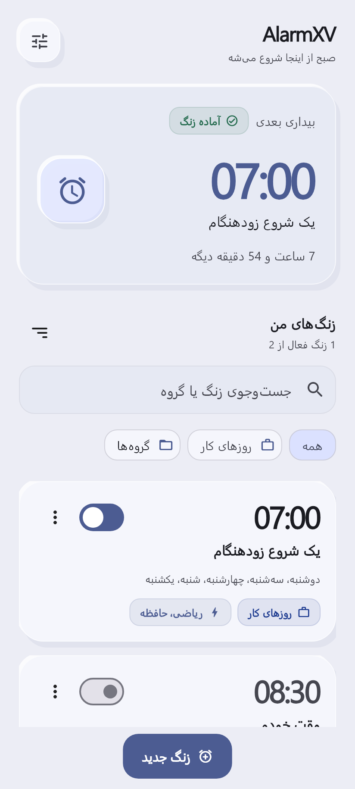
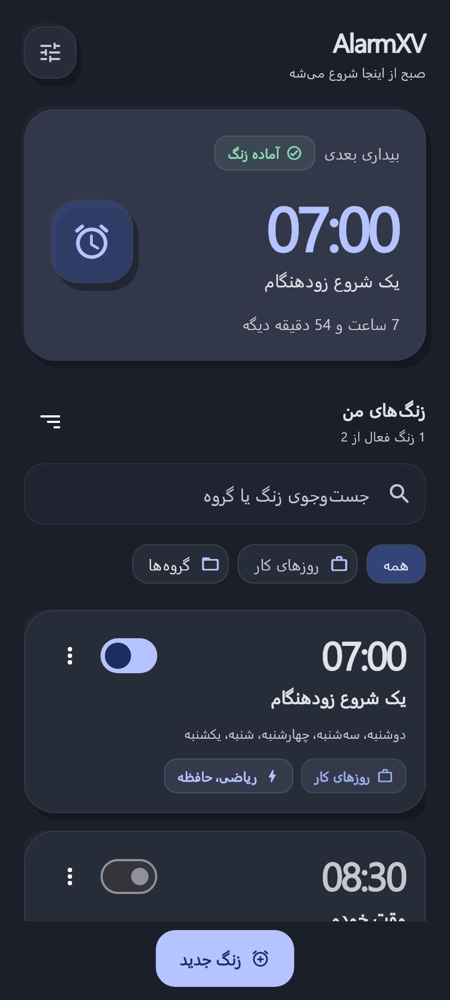

# AlarmXV

### A better morning starts with actually waking up.
### صبح خوب، با واقعاً بیدارشدن شروع می‌شود.

An Android alarm clock for heavy sleepers — local alarms, wake-up missions, and a little persistence.

[Download / دانلود](https://github.com/bardia-us/AlarmXV/releases/latest) · [What’s new / تغییرات](CHANGELOG.md) · [Report a bug / گزارش مشکل](https://github.com/bardia-us/AlarmXV/issues)

&nbsp;&nbsp;

Design preview · نمونهٔ زبان طراحی؛ نسخهٔ جدید هنوز منتشر نشده

---

## فارسی

AlarmXV برای وقتی ساخته شده که دکمهٔ خاموش‌کردن آلارم، زیادی راحت است. زنگ را تنظیم کن، مأموریت بیدارشدن را انتخاب کن و اگر خواستی، از بررسی بیداری کمک بگیر تا دوباره نخوابی.

### نسخهٔ منتشرشده — 1.2.0

- زنگ دقیق هفتگی با موتور Native Android و بازیابی بعد از راه‌اندازی مجدد گوشی.
- صفحهٔ زنگ روی قفل گوشی، پخش تکرارشوندهٔ صدا و لرزش.
- مأموریت‌های ریاضی، حافظه و تکان‌دادن گوشی.
- Snooze و بررسی بی‌صدای بیداری با فرصت تأیید ۶۰ ثانیه‌ای.
- انتخاب صدا از صداهای خود گوشی؛ نگهداری آلارم‌ها به‌صورت محلی.

### در حال توسعه — 2.0 Preview

طراحی Clay با عمق نرم، تم روشن/تیره/سیستم و هشت رنگ قابل انتخاب؛ گروه‌های آلارم، جست‌وجو، تکثیر، تنظیم سختی مأموریت‌ها، تایپ و ترتیب اعداد. نمایش تازه‌های نسخه و بررسی دستی آپدیت هم بخشی از این بازطراحی است.

دو حالت جدا داری: «زنگ عادی» برای قطع مستقیم و صدای قابل تنظیم، و «بیداری مأموریتی» برای وقتی که می‌خواهی با حل مأموریت بیدار بمانی. حالت عادی صدای گوشی را به حداکثر قفل نمی‌کند و بررسی اجباری بیداری ندارد.

تغییر روشن/تیره با دکمهٔ ماه و خورشید بالای صفحه انجام می‌شود؛ پیش‌فرض از سیستم پیروی می‌کند. نوار ناوبری Android در دسترس می‌ماند و منوها و دکمه‌های پایین از شکل و عمق مشترک Clay استفاده می‌کنند.

این پیش‌نمایش هنوز انتشار عمومی نیست. [وضعیت بررسی و تست‌ها](docs/qa/STATUS.md) محدودیت‌ها و نتیجهٔ واقعی هر مرحله را ثبت می‌کند؛ نسخهٔ پایدار فعلی همان 1.2.0 است.

### کدام فایل دانلود؟

| فایل | مناسب برای |
|---|---|
| `arm64-v8a` | بیشتر گوشی‌های جدید اندرویدی |
| `armeabi-v7a` | گوشی‌های قدیمی ۳۲ بیتی |
| `universal`، اگر در نسخه موجود باشد | همهٔ معماری‌های پشتیبانی‌شده، با حجم بیشتر |

دسترسی‌های «آلارم دقیق»، «اعلان»، «نمایش تمام‌صفحه» و «نمایش روی برنامه‌ها» را در صورت درخواست داخل اپ فعال کن. رفتار روی قفل و در پس‌زمینه به نسخهٔ Android و محدودیت‌های سازنده هم بستگی دارد. Force stop از تنظیمات سیستم می‌تواند اجرای آلارم‌ها را متوقف کند.

## English

AlarmXV helps you stay awake after your alarm. Set a weekly alarm, choose a wake-up mission, and optionally enable a silent follow-up check.

### Published — 1.2.0

- Native Android exact alarms, weekly repeats and reboot rescheduling.
- Lock-screen ringing, looping sound and vibration.
- Math, Memory and Shake missions.
- Per-alarm snooze and a silent Wake-up Checker with a 60-second response window.
- System sound picker and local alarm storage, with no account required.

### In development — 2.0 Preview

A coherent soft-depth Clay interface; light, dark and system themes; eight accents; alarm groups; search and duplication; configurable missions; typing and number ordering; in-app release notes and an on-demand update check.

Choose **Normal alarm** for direct dismissal and freely adjustable system/custom volume, or **Mission alarm** for the stricter wake-up flow. Normal alarms do not enforce maximum volume or mandatory wake checks.

The animated moon/sun control switches appearance while system following remains the default. Android navigation stays available; rounded menus and floating action edges share the same Clay surfaces.

The preview is not a public release. See the [QA status](docs/qa/STATUS.md) for completed checks and device-test limitations. Version 1.2.0 remains the current public release.

For downloads, choose **arm64-v8a** for most modern phones, **armeabi-v7a** for older 32-bit phones, or **universal** when offered. Enable the Android alarm and notification access requested in the app. Lock-screen delivery depends on Android and manufacturer restrictions; a system Force stop can prevent alarms from running.

## Privacy · حریم خصوصی

Alarm data and preferences stay on the device. The preview contacts GitHub only when you tap **Check for updates**; it opens a compatible APK in your browser and does not install updates silently. No camera or microphone access is used.

## Contribute · مشارکت

Licensed under [GNU GPL v3.0](LICENSE). کد این پروژه با مجوز GPL-3.0 منتشر می‌شود.

Found a problem? [Open an issue](https://github.com/bardia-us/AlarmXV/issues) with the app version, phone model, Android version and steps to reproduce it. Do not attach passwords, private signing keys or personal alarm data.

مشکلی دیدی؟ نسخهٔ اپ، مدل گوشی، نسخهٔ Android و روش تکرار مشکل را در [Issues](https://github.com/bardia-us/AlarmXV/issues) بنویس. پیشنهاد و مشارکت در طراحی، دسترس‌پذیری و تست هم خوش‌آمد است.

---

Built with Flutter + native Android. مستقل از Alarmy؛ از نام، کد یا دارایی‌های اختصاصی آن استفاده نمی‌کند.
